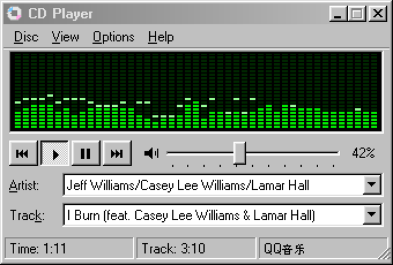
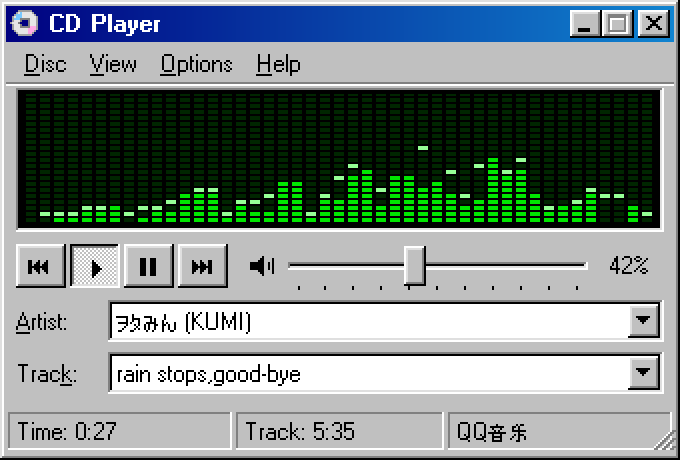
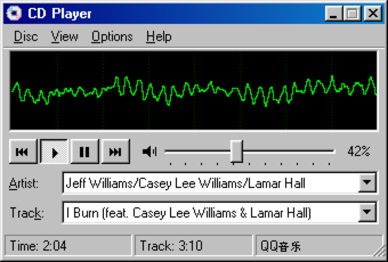
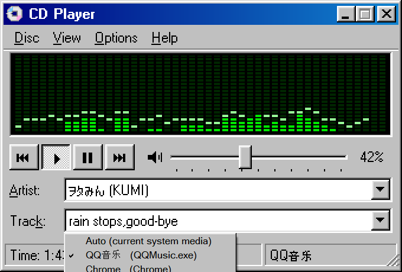

<p align="center">
  
</p>

<h1 align="center">CD Player 98</h1>

<p align="center"><b>English</b> | <a href="README.zh-CN.md">简体中文</a></p>

> A Windows 98–style "now playing" widget for Windows 10/11. It shows what's playing in any media app and has transport controls, system volume, and a green LED spectrum analyzer.

<p align="center">
  
</p>

## Features

- **Now playing**: reads title, artist, and position from the Windows system media session, the same source as the media card in the taskbar volume flyout. It works with QQ Music, NetEase Cloud Music, Spotify, and web players in Chrome / Edge. The players need no plugins.
- **Transport controls**: previous / play / pause / next. If the player doesn't support these commands, the widget sends keyboard media keys instead.
- **System volume**: a 98-style slider. The mouse wheel adjusts the volume, and one click mutes.
- **LED spectrum / oscilloscope**: WASAPI loopback capture of the system audio output, run through a hand-written FFT. The bars are log-spaced from 40 Hz to 16 kHz, with peak hold.
- **Authentic 98 look**: the UI is drawn at 1× pixel scale and scaled up with crisp, even pixels (any size from 100% to 400%), using the MS Sans Serif bitmap font that ships with Windows. The gradient title bar, 3D buttons, dithered pressed state, etched separators, and 98-style drop-down menus are all drawn by hand. Chinese and Japanese text falls back to the system bitmap fonts.
- **Lives in the tray**: no taskbar button. Click the tray icon to show or hide the window, or right-click it for playback controls. It can optionally start with Windows (off by default).
- **Lightweight**: a single exe of under 70 KB with no third-party dependencies. CPU usage is around 1% while music plays and near zero when it's silent or hidden in the tray.

## Screenshots

| Spectrum | Oscilloscope | Choosing which player to follow |
| :---: | :---: | :---: |
|  |  |  |

## Download

Download `CDPlayer.exe` from the [**latest release**](https://github.com/Buck008/Win98CDPlayer/releases/latest), put it anywhere, and double-click to run. It's a single file with no installer, and it leaves nothing behind except its settings in the registry.

> The exe isn't code-signed, so Windows SmartScreen may show "Windows protected your PC" the first time you run it. Click **More info → Run anyway**. You can also build it yourself from source, as shown below.

## Build from source

**Requirements**: Windows 10 version 1809 or later, or Windows 11. The app needs .NET Framework 4.x, which Windows 10/11 already include.

You don't need Visual Studio or the .NET SDK. The C# compiler that ships with Windows builds it:

```bat
git clone https://github.com/Buck008/Win98CDPlayer.git
cd Win98CDPlayer
build.bat
CDPlayer.exe
```

For development, `CDPlayer.exe --snapshot out.png` renders the UI with fake data to an image, and `CDPlayer.exe --export-icon <dir>` regenerates the pixel-art `CDPlayer.ico` and `icon.png`.

## Controls

| Input | Action |
| --- | --- |
| ⏮ ▶ ⏸ ⏭ buttons | Previous / play / pause / next |
| `Space` | Play / pause |
| `←` `→` | Previous / next track |
| Slider, mouse wheel, `↑` `↓` | System volume |
| Speaker icon, `M` | Mute |
| Click the display, `V` | Toggle spectrum ↔ waveform |
| Artist / Track drop-down arrows | Choose which player to follow. The default, "Auto", prefers whichever player is currently playing |
| Drag the bottom-right corner, `Ctrl` + wheel | Resize freely (100%–400%) |
| Drag the title bar | Move the window |
| Minimize button | Hide to the tray |
| Tray icon | Left-click: show / hide. Right-click: tray menu (see below) |

## Menus

| Menu | Item | What it does |
| --- | --- | --- |
| **Disc** | Play / Pause | Toggle playback (`Space`) |
| | Previous Track / Next Track | Skip (`←` / `→`) |
| | Exit | Quit the app |
| **View** | Spectrum / Waveform | Choose the visualizer (`V` or click the display) |
| | Zoom | Presets from 100% to 300%; drag the corner for any size up to 400% |
| | Always on Top | Keep the window above other windows |
| **Options** | Media Source | Follow a specific app instead of "Auto" (same list as the Artist / Track drop-downs) |
| | Mute | Mute system audio (`M`) |
| | Volume Control... | Open the Windows Volume Mixer |
| | Start with Windows | Launch at sign-in (off by default) |
| **Help** | About CD Player | Version and keyboard shortcuts |
| **Tray icon** (right-click) | Show / Hide, Play / Pause, Previous, Next, Start with Windows, About, Exit | |

Settings (zoom, display mode, always on top, window position, followed player) are saved in the registry under `HKCU\Software\CDPlayer98`.

## How it works

| Feature | Implementation |
| --- | --- |
| Now playing / transport | WinRT `GlobalSystemMediaTransportControlsSessionManager` (SMTC), referencing the `.winmd` files in `C:\Windows\System32\WinMetadata` directly, so no Windows SDK is required |
| Spectrum / waveform | WASAPI shared-mode loopback capture (`AUDCLNT_STREAMFLAGS_LOOPBACK`) → 2048-point Hann-windowed FFT → log-spaced bands with pink-noise tilt compensation |
| Volume | Core Audio `IAudioEndpointVolume` via COM interop |
| UI | 1× logical canvas (340×230); non-antialiased bitmap text drawn with GDI, nearest-neighbor upscaling to the next integer factor, then a smooth resample to the exact size; Per-Monitor V2 DPI aware |

All the code is in the single file [`CDPlayer.cs`](CDPlayer.cs). It is written in C# 5 and compiles with the `csc.exe` that comes with .NET Framework 4.

## Known limitations

- The visualizer shows the **whole system's** audio output, so videos and notification sounds make it move too.
- The volume slider controls the system master volume, not the volume of an individual player.
- Playback position comes from what the player reports to Windows. Players that don't report it show `--:--`, and players that don't provide an artist show `(Unknown Artist)`.

## License

[MIT](LICENSE)

This project is not affiliated with Microsoft. "Windows 98" and "CD Player" are used only to describe the visual style.
