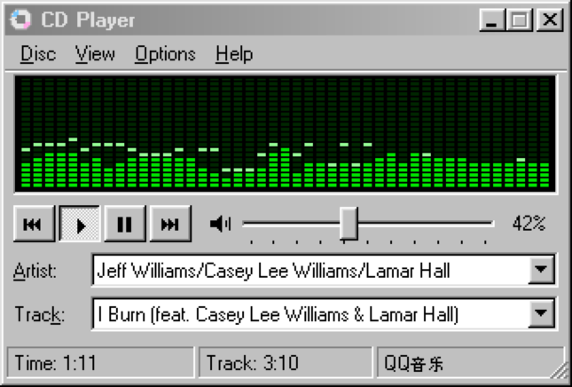
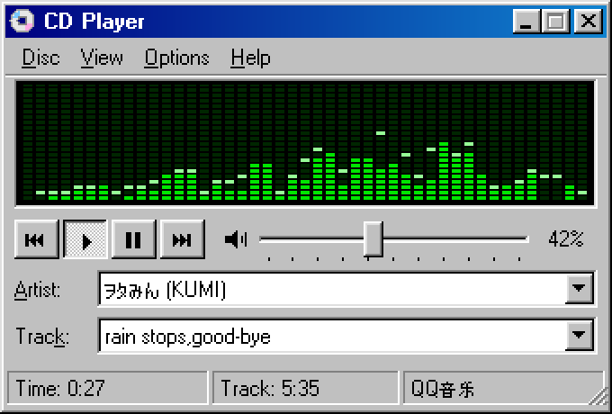
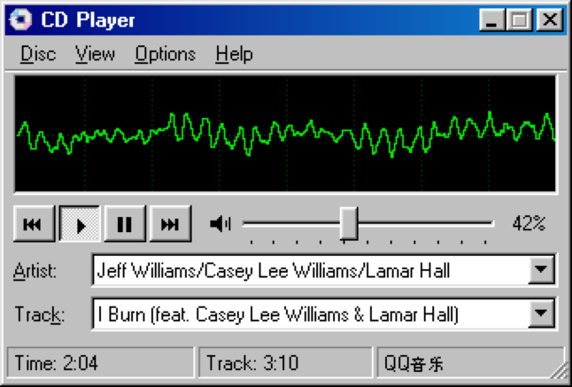
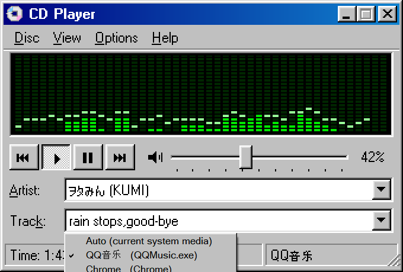

<p align="center">
  
</p>

<h1 align="center">CD Player 98</h1>

<p align="center"><a href="README.md">English</a> | <b>简体中文</b></p>

> 一个 Windows 98 风格的「正在播放」小窗：显示系统里正在放的歌、切歌、调音量，还有一块会跳的绿色 LED 频谱。
>
> A Windows 98–style "now playing" widget for Windows 10/11 — shows what's playing in any media app, with transport controls, system volume and a green LED spectrum analyzer.

<p align="center">
  
</p>

## 特性

- **显示当前播放**：通过 Windows 系统媒体会话（就是任务栏音量弹窗里那个媒体卡片）读取歌名、歌手和进度。QQ音乐、网易云音乐、Spotify、Chrome / Edge 里的网页播放都支持，不需要给播放器装任何插件。
- **播放控制**：上一首 / 播放 / 暂停 / 下一首，播放器不支持时自动退回到键盘媒体键。
- **系统音量**：98 风格滑块、滚轮调节、一键静音。
- **LED 频谱 / 示波器**：用 WASAPI 回环采集系统声音输出，自己实现的 FFT，40 Hz–16 kHz 对数分布，带峰值保持。
- **地道的 98 味**：界面按 1 倍像素绘制再放大，100%–400% 任意大小，像素都粗细均匀；使用 Windows 自带的 MS Sans Serif 点阵字体；标题栏渐变、立体按钮、点状按下态、蚀刻分隔线、98 风格下拉菜单都是手画的。中日文会自动回退到系统点阵字体。
- **住在托盘里**：不占任务栏。左键点托盘图标显示 / 隐藏窗口，右键是播放控制菜单。可选开机自启（默认关闭）。
- **轻量**：单个不到 70 KB 的 exe，零第三方依赖；放歌时 CPU 占用约 1%，没声音或藏在托盘时几乎为零。

## 截图

| 频谱 | 示波器波形 | 选择要跟随的播放器 |
| :---: | :---: | :---: |
|  |  |  |

## 下载

从 [**最新 Release**](https://github.com/Buck008/Win98CDPlayer/releases/latest) 下载 `CDPlayer.exe`，放到任意位置，双击就能用。只有这一个文件，不用安装，除了注册表里的设置不会留下任何东西。

> exe 没有代码签名，第一次运行时 Windows SmartScreen 可能提示「Windows 已保护你的电脑」，点 **更多信息 → 仍要运行** 即可。不放心的话也可以按下面的方法自己从源码编译。

## 从源码构建

**系统要求**：Windows 10 1809 或更新版本 / Windows 11。需要 .NET Framework 4.x，Windows 10/11 已经自带。

不需要安装 Visual Studio 或 .NET SDK，用系统自带的 C# 编译器就能构建：

```bat
git clone https://github.com/Buck008/Win98CDPlayer.git
cd Win98CDPlayer
build.bat
CDPlayer.exe
```

开发用：`CDPlayer.exe --snapshot out.png` 会用假数据把界面渲染成图片；`CDPlayer.exe --export-icon <目录>` 会重新生成像素图标 `CDPlayer.ico` 和 `icon.png`。

## 操作

| 操作 | 效果 |
| --- | --- |
| ⏮ ▶ ⏸ ⏭ 按钮 | 上一首 / 播放 / 暂停 / 下一首 |
| `空格` | 播放 / 暂停 |
| `←` `→` | 上一首 / 下一首 |
| 滑块、鼠标滚轮、`↑` `↓` | 系统音量 |
| 点喇叭图标、`M` | 静音 |
| 点黑色显示区、`V` | 切换 频谱 ↔ 波形 |
| Artist / Track 的下拉箭头 | 选择跟随哪个播放器（默认「Auto」：优先正在播放的那个） |
| 拖右下角、`Ctrl` + 滚轮 | 自由缩放（100%–400%） |
| 拖标题栏 | 移动窗口 |
| 最小化按钮 | 隐藏到托盘 |
| 托盘图标 | 左键：显示 / 隐藏；右键：托盘菜单（见下） |

## 菜单

| 菜单 | 菜单项 | 作用 |
| --- | --- | --- |
| **Disc** | Play / Pause | 播放 / 暂停（`空格`） |
| | Previous Track / Next Track | 上一首 / 下一首（`←` / `→`） |
| | Exit | 退出程序 |
| **View** | Spectrum / Waveform | 选择显示频谱还是波形（`V` 或点击显示区） |
| | Zoom | 100%–300% 缩放预设；拖右下角可任意缩放到 400% |
| | Always on Top | 窗口置顶，始终显示在其他窗口上面 |
| **Options** | Media Source | 指定跟随某个播放器，而不是「Auto」自动选择（和 Artist / Track 下拉箭头里的列表相同） |
| | Mute | 系统静音（`M`） |
| | Volume Control... | 打开 Windows 音量合成器 |
| | Start with Windows | 开机自启（默认关闭） |
| **Help** | About CD Player | 版本号和快捷键 |
| **托盘图标**（右键） | 显示 / 隐藏、播放 / 暂停、上一首、下一首、开机自启、About、退出 | |

设置（缩放、显示模式、置顶、窗口位置、跟随的播放器）保存在注册表 `HKCU\Software\CDPlayer98`。

## 工作原理

| 功能 | 实现 |
| --- | --- |
| 正在播放 / 播放控制 | WinRT `GlobalSystemMediaTransportControlsSessionManager`（SMTC），直接引用 `C:\Windows\System32\WinMetadata` 下的 `.winmd`，不依赖 Windows SDK |
| 频谱 / 波形 | WASAPI 共享模式回环采集（`AUDCLNT_STREAMFLAGS_LOOPBACK`）→ 2048 点 Hann 窗 FFT → 对数分组 + 粉噪倾斜补偿 |
| 音量 | Core Audio `IAudioEndpointVolume`（COM 互操作） |
| 界面 | 1x 逻辑画布（340×230），GDI 绘制非抗锯齿点阵文字，先最近邻放大到相邻的整数倍、再平滑缩放到目标大小；Per-Monitor V2 DPI 感知 |

全部代码在 [`CDPlayer.cs`](CDPlayer.cs) 一个文件里，用 C# 5 编写，可以直接用 .NET Framework 4 自带的 `csc.exe` 编译。

## 已知限制

- 频谱显示的是**整个系统**的声音输出，视频、提示音也会让它跳动。
- 音量滑块调的是系统主音量，不是单个播放器的音量。
- 进度时间来自播放器上报给系统的数据，个别播放器不上报时显示 `--:--`；有些播放器不提供歌手信息，会显示 `(Unknown Artist)`。

## License

[MIT](LICENSE)

本项目与 Microsoft 无关。「Windows 98」和「CD Player」仅用于描述界面风格。
